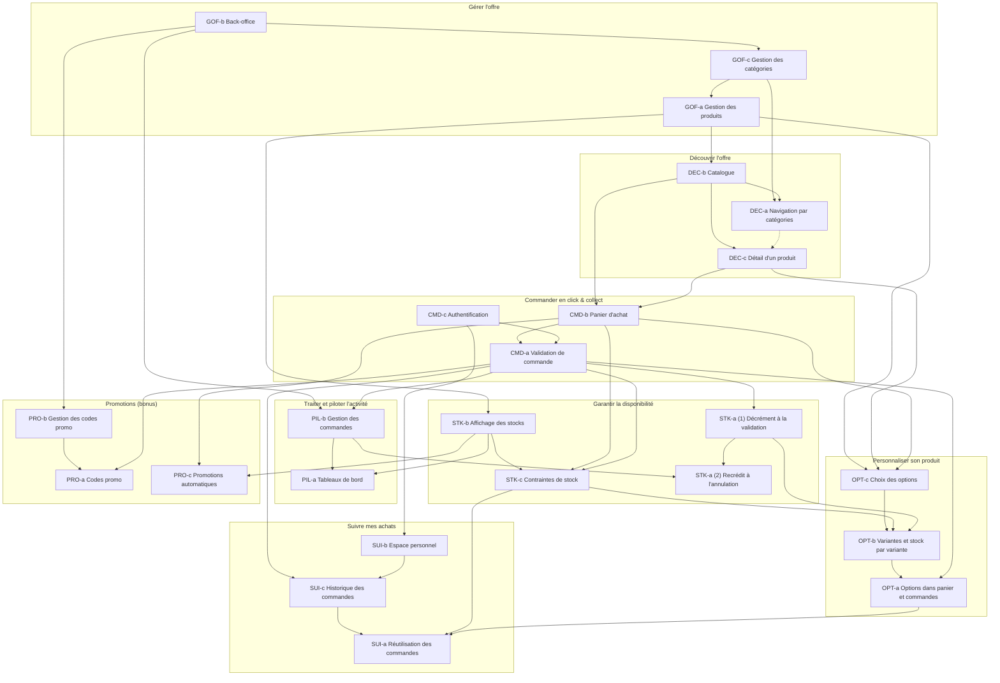

# Justification de chaque lien

**1. Gérer l'offre (GOF)**

**GOF-b ➔ GOF-c** : L'accès au back-office est nécessaire pour pouvoir administrer les catégories.

**GOF-c ➔ GOF-a** : Les catégories doivent être créées en amont pour pouvoir y associer les nouveaux produits.

### 2. Découvrir l'offre (DEC)

**GOF-a ➔ DEC-b** : Les produits doivent être enregistrés dans une base de données pour apparaître dans un catalogue.

**GOF-c ➔ DEC-a** : Les catégories gérées en back-office permettent la mise en place de la navigation par catégories pour le client.

**DEC-b ➔ DEC-a** : Le catalogue de base permet de filtrer l'affichage vers la navigation par catégories.

**DEC-b ➔ DEC-c** : Depuis la vue du catalogue, le visiteur peut accéder à la fiche détail d'un produit.

**DEC-a -.-➔ DEC-c** : La vue par catégorie permet aussi d'accéder aux détails d'un produit.

### 3. Commander en click & collect (CMD)

**DEC-b ➔ CMD-b** : Les produits peuvent être ajoutés au panier d'achat directement depuis le catalogue.

**DEC-c ➔ CMD-b** : L'ajout au panier s'effectue aussi depuis la fiche détaillée du produit.

**CMD-b ➔ CMD-a** : Le panier doit contenir des articles pour permettre la validation de la commande.

**CMD-c ➔ CMD-a** : L'authentification de l'utilisateur est requise pour finaliser l'achat et enregistrer la commande.

### 4. Garantir la diponibilité (STK)

**GOF-a ➔ STK-b** : Les seuils et les niveaux de stocks sont définis lors de la création des produits avant de pouvoir être affichés.

**STK-b ➔ STK-c** : La connaissance de l'état des stocks permet d'appliquer les contraintes limitant les ajouts impossibles.

**CMD-b ➔ STK-c** : Le système vérifie les contraintes de stock à chaque modification ou ajout dans le panier.

**CMD-a ➔ STK-c** : Une ultime vérification des quantités disponibles s'effectue au moment de la validation de la commande.

**CMD-a ➔ STK-a(1)** : La validation effective d'une commande déclenche immédiatement la décrémentation du stock.

**STK-a(1) ➔ STK-a(2)** : Le mécanisme de décrémentation est indispensable pour concevoir la logique inverse de recrédit.

**PIL-b ➔ STK-a(2)** : L'action d'annuler une commande depuis le back-office déclenche le recrédit du stock.

### 5. Traiter et piloter l'activité (PIL)

**GOF-b ➔ PIL-b** : L'interface du back-office héberge la section permettant aux administrateurs de gérer les commandes.

**CMD-a ➔ PIL-b** : Les nouvelles commandes validées par les clients alimentent la liste gérée par l'administrateur.

**PIL-b ➔ PIL-a** : L'historique et les statuts des commandes permettent de générer les statistiques du tableau de bord.

**STK-b ➔ PIL-a** : Les données de disponibilité alimentent le tableau de bord pour alerter sur les stocks faibles.

### 6. Personnaliser son produit (OPT)

**GOF-a ➔ OPT-c** : L'administrateur doit configurer les options possibles lors de la création du produit en back-office.

**DEC-c ➔ OPT-c** : Le visiteur choisit les options souhaitées directement sur la fiche détaillée du produit.

**CMD-b ➔ OPT-c** : Le client a la possibilité de modifier les options d'un article depuis son panier.

**OPT-c ➔ OPT-b** : La sélection d'une option définit précisément à quelle variante de produit elle correspond.

**STK-c ➔ OPT-b** : Les règles limitant l'ajout au panier s'appliquent de manière ciblée sur le stock de chaque variante.

**STK-a(1) ➔ OPT-b** : La décrémentation automatique s'applique au stock spécifique de la variante commandée.

**OPT-b ➔ OPT-a** : Les choix de variantes doivent être associés aux lignes d'articles dans le panier.

**CMD-a ➔ OPT-a** : Lors de la confirmation de l'achat, les options sont enregistrées avec le reste de la commande.

### 7. Suivre mes achats (SUI)

**CMD-c ➔ SUI-b** : L'utilisateur doit s'authentifier pour pouvoir accéder à son espace personnel.

**CMD-a ➔ SUI-c** : Les commandes validées viennent enrichir l'historique des achats du client.

**SUI-b ➔ SUI-c** : L'espace personnel offre un accès vers l'historique des commandes du client.

**SUI-c ➔ SUI-a** : L'historique permet d'utiliser une commande antérieure.

**STK-c ➔ SUI-a** : Le système vérifie la disponibilité des articles avant de relancer une ancienne commande.

**OPT-a ➔ SUI-a** : Le transfert d'une ancienne commande vers le panier récupère les mêmes options de configuration.

### 8. Promotions (PRO)

**GOF-b ➔ PRO-b** : Le back-office offre une interface dédiée pour configurer les codes promotionnels.

**PRO-b ➔ PRO-a** : Un code promotionnel doit être créé avant qu'un client ne puisse l'utiliser.

**CMD-a ➔ PRO-a** : Le champ de saisie du code promotionnel est disponible lors de l'étape de validation.

**STK-b ➔ PRO-c** : Le calcul de la promotion automatique identifie le produit disposant du plus grand stock.

**CMD-b ➔ PRO-c** : Les réductions automatiques sont calculées et affichées directement dans le panier d'achat.

# lien figma :
https://www.figma.com/design/Lxr41GAJE4tSiMkKBorkv8/Malo_Etchegoyen?node-id=108-7299&t=uT7WcCtp2u6rf5TT-1

Admin : admin motdepasse